# ConfirmIQ – FX Trade Confirmation & Client Document Platform

ConfirmIQ is a post-trade operations platform that automates the **confirmation lifecycle of FX trades** – from trade booking through document generation, four-eyes approval, client delivery, automated matching of client paper, break management and final confirmation – with a complete audit trail.

It is modelled on how bank operations teams confirm OTC trades with clients, and is built as a production-style full-stack application: **Spring Boot 3.5 / Java 21**, **React 19 + TypeScript + MUI**, **SQLite** (zero setup), shipped as **one Docker image**.

> Meridian Capital is a fictional bank; all counterparties, LEIs and accounts are synthetic demo data.

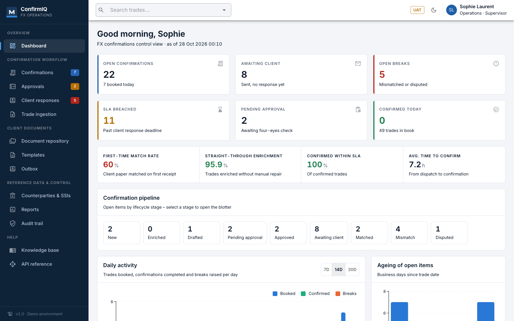

---

## Highlights

| Area | What it does |
|---|---|
| **Trade ingestion** | XSD-validated booking XML (FpML-inspired) and a REST API, idempotent on the front-office reference; business validation of FX economics (T+2 spot, forward/swap/NDF date rules, market quotation convention, rate vs. amount consistency). |
| **Enrichment / STP** | Automatic enrichment with counterparty static data and standard settlement instructions (SSIs); incomplete static data drops the trade into an exception queue. |
| **Lifecycle state machine** | 11 statuses, 13 role-gated actions. **Four-eyes**: the preparer of a draft can never approve it. Amendments create a new economic version and require fresh approval; cancellations issue a cancellation notice. |
| **Document generation** | Letterhead PDFs (OpenPDF) from **versioned templates** with per-client overrides; both parties' SSIs, legal clauses, **DRAFT watermark**, electronic issue stamp, and a **QR code with a SHA-256 fingerprint of the economic terms**. |
| **Inbound matching** | Client responses arrive by ops upload, the **client portal**, or a **watched inbox folder** (email/SFTP simulation). Documents are identified by QR or quoted reference; terms are extracted and matched **field by field with tolerances**; returned paper that is stale or edited is flagged. |
| **Break management** | Side-by-side diff of booking vs. client document, disputes with reasons, supervisor "accept break", automatic **chasers** and **escalation** against counterparty SLAs. |
| **Client portal** | Counterparties review terms and the PDF, **affirm** with one click, **dispute**, or upload a signed copy – strictly scoped to their own trades. |
| **Control & MI** | Ops dashboard (open items, breaks, SLA breaches, first-time match rate, STP rate, ageing), Excel/CSV extracts, end-of-day outstanding-confirmations PDF, append-only **audit trail**, simulated **outbox**. |
| **Knowledge base** | In-app wiki: post-trade lifecycle, FX spot/forward/swap/NDF with worked examples, SSIs, CLS, LEI/BIC/MT300, ISDA, EMIR/Dodd-Frank, four-eyes, chasers – plus an A–Z glossary. |

## The confirmation flow

```
 Front office ──XML / REST──▶ Booked ──auto──▶ Enriched ──▶ Drafted ──▶ Pending approval ──(checker)──▶ Approved
                               │ missing SSI                    ▲  reject ◀───────┘                    │ send
                               ▼                                │                                      ▼
                         Exception queue                     Amend ◀── Mismatch / Disputed ◀── Awaiting client ──▶ chasers ▶ escalation
                                                                            ▲   client paper matched?   │
                                                                            └──────── no ───────────────┤ yes / client affirms
                                                                                                        ▼
                                                                                              Matched ──▶ Confirmed
```

## Screenshots

| | |
|---|---|
| 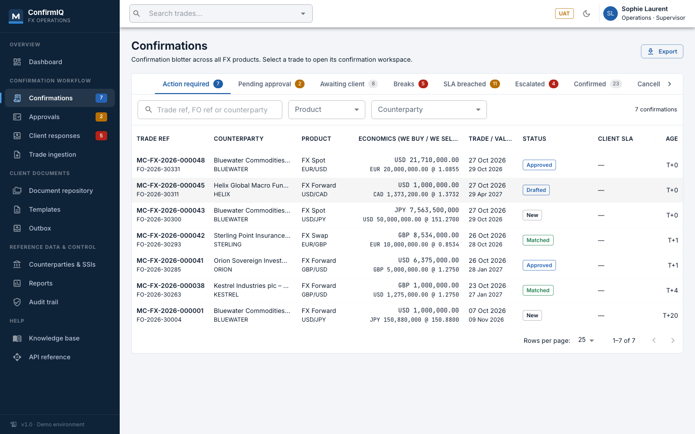 **Confirmation blotter** – work queues, SLA, exports | 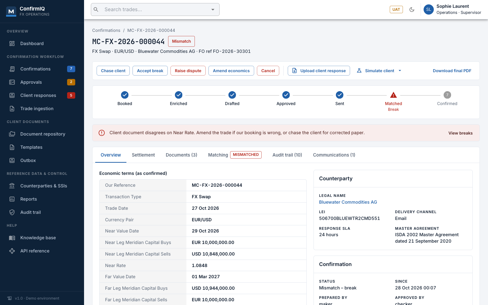 **Trade workspace** – lifecycle, actions, break alert |
| 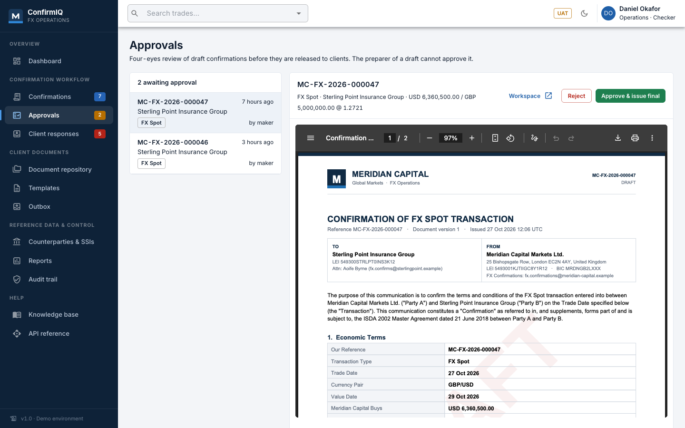 **Four-eyes approvals** – terms vs. draft PDF | 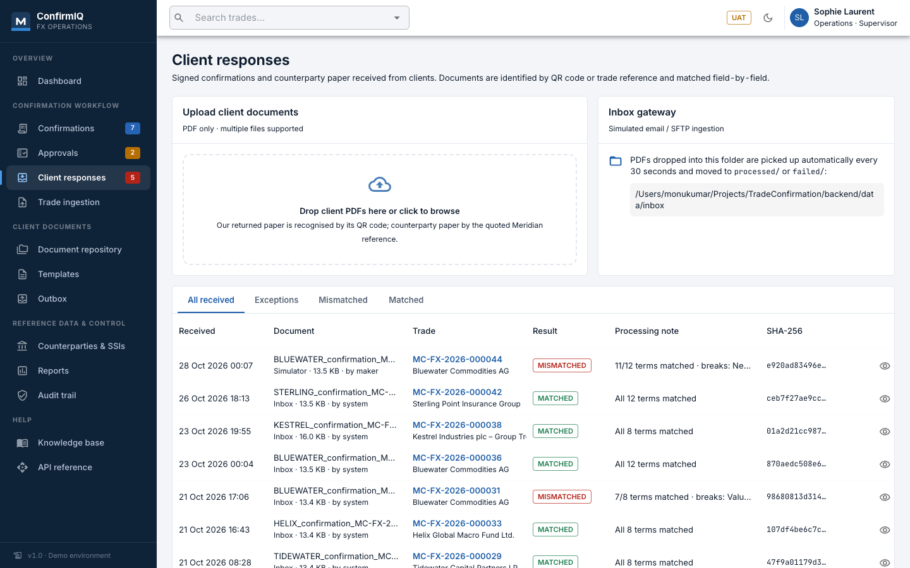 **Client responses** – QR/reference identification and matching |
| 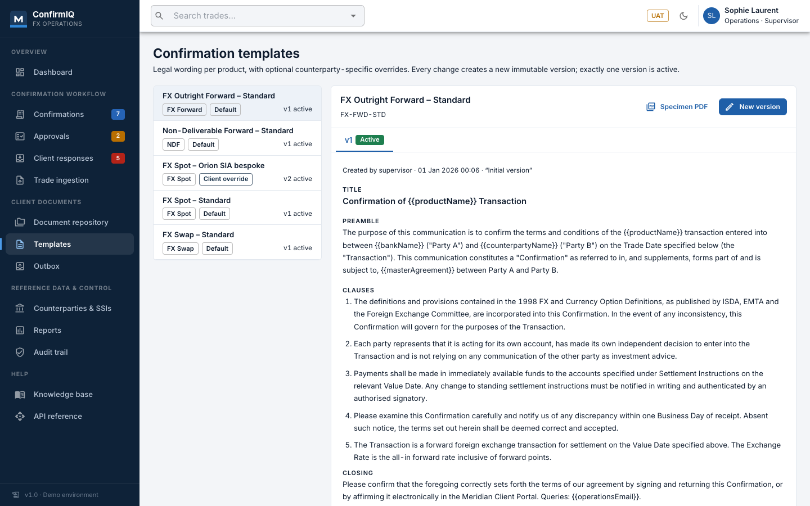 **Versioned templates** with specimen preview | 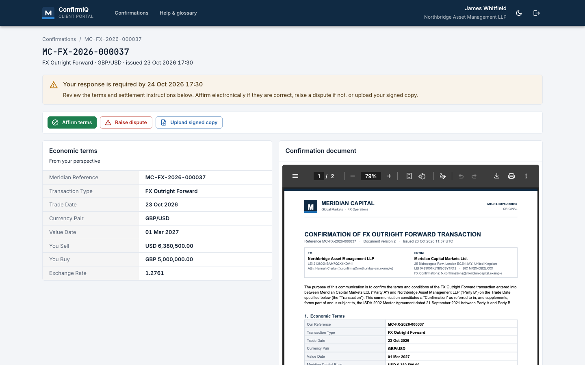 **Client portal** – affirm, dispute, upload |
| 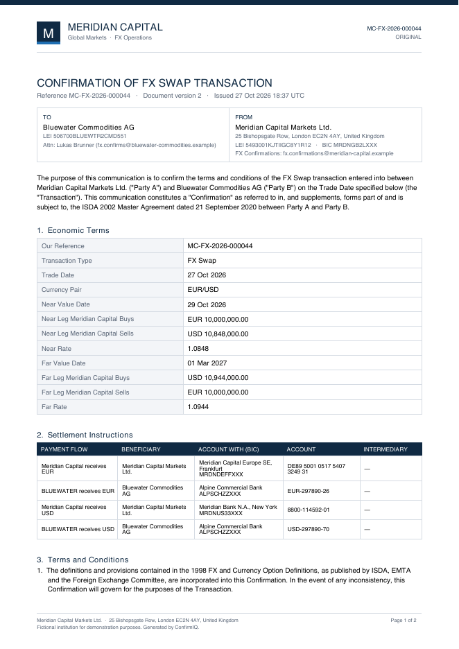 **Generated confirmation** | 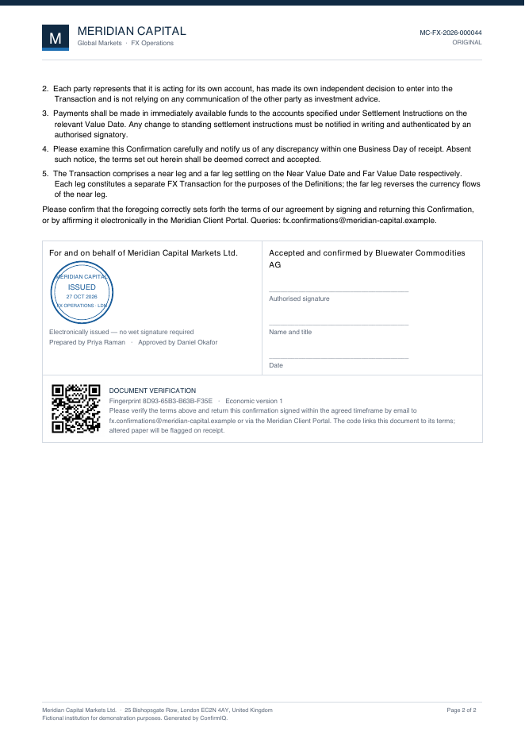 **E-stamp and QR fingerprint** |
| 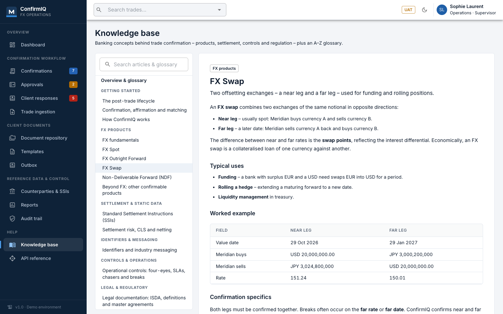 **Knowledge base** | 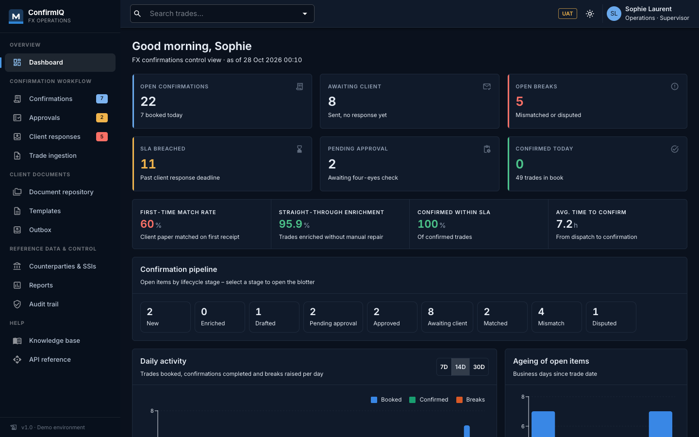 **Dark mode** |

## Quick start

### Docker (one command)

```bash
docker compose up --build
# open http://localhost:8080
```

### Local development

Prerequisites: Java 21+, Node 20+.

```bash
# API on :8080 – creates ./data/confirmiq.db and seeds ~50 demo trades on first start
cd backend && ./mvnw spring-boot:run

# UI on :5173 (proxies /api to :8080)
cd frontend && npm install && npm run dev
```

### Demo accounts (password `Demo@2026`)

| Username | Role | Try this |
|---|---|---|
| `maker` | Operations maker | Generate a draft, submit it, send it, simulate a client break, amend |
| `maker2` | Second maker | – |
| `checker` | Operations checker | Approve or reject drafts in **Approvals** (cannot approve own work) |
| `supervisor` | Operations supervisor | Edit counterparties/SSIs, publish template versions, accept breaks, cancel |
| `client` | Client portal (Northbridge Asset Management) | Affirm or dispute open confirmations |
| `client.aurora` | Client portal (Aurora Pension Fund) | – |

**A 3-minute walkthrough:** sign in as `maker` → *Trade ingestion* → upload `samples/trades/booking-batch-mixed.xml` → open a trade → *Generate draft* → *Submit* → sign in as `checker` → *Approvals* → *Approve & issue final* → back as `maker` → *Send to client* → *Simulate client → Break: exchange rate* → open *Matching* to see the field diff → *Amend economics* → re-approve → *Simulate client → Matching confirmation* → *Mark confirmed* → review the *Audit trail* tab.

To test the inbox gateway, download any final PDF (or simulated counterparty paper) and drop it into `backend/data/inbox/` – it is processed within 30 seconds.

## Architecture

```
frontend/  React 19 · TypeScript · MUI 9 · MUI X DataGrid & Charts · TanStack Query · React Router
backend/   Spring Boot 3.5 · Java 21 · Spring Security (JWT, roles) · Spring Data JPA · Flyway
           SQLite (WAL) · OpenPDF · PDFBox 3 · ZXing · Apache POI · springdoc-openapi
Docker     node build ─▶ maven build (UI bundled as static) ─▶ JRE 21 alpine, non-root, /data volume
```

| Backend package | Responsibility |
|---|---|
| `trade` | Booking model, XML parser (XSD, XXE-hardened), business validation, ingestion, query/detail views |
| `product` | Pluggable `ProductTermsProvider` (FX today) – the terms printed, hashed and matched |
| `confirmation` | State machine (`ConfirmationAction`), workflow service, blotter queries, chaser scheduler |
| `document` | PDF rendering, QR codes, storage abstraction, repository API |
| `template` | Versioned confirmation templates with counterparty overrides |
| `inbound` | Term extraction, matching engine, inbox watcher, counterparty-paper simulator |
| `counterparty` | Static data: LEI, contacts, SSIs (supersede-not-overwrite) |
| `portal` | Client-facing API scoped to the caller's counterparty |
| `analytics`, `report`, `audit`, `outbox` | KPIs, exports, append-only audit log, simulated delivery |

Design notes:

- **Money is exact.** `BigDecimal` everywhere; persisted as decimal text because SQLite would otherwise store floats.
- **SQLite done properly.** WAL journal, single-writer connection pool, Flyway migrations, foreign keys on, Hibernate DDL disabled.
- **Replayable workflow.** Every workflow method takes an explicit actor and timestamp, so the demo seeder drives real trades through the real state machine – the seeded documents, matches and audit history are genuine application output.
- **Security.** Stateless JWT (HS256), BCrypt passwords, method-level role checks, client data isolation, RFC 7807 problem responses, XXE-safe XML parsing, path-traversal-safe storage.

API documentation: **http://localhost:8080/swagger-ui.html** (sign in via `POST /api/v1/auth/login`, then *Authorize* with the token).

## Tests

```bash
cd backend && ./mvnw test        # matching tolerances, PDF term extraction, XSD/XXE, FX validation, state machine rules
cd frontend && npm run build && npm run lint
```

## Deployment

The image is self-contained: UI and API on one port, data under `/data` (SQLite file, documents, inbox).

| Variable | Default | Purpose |
|---|---|---|
| `APP_JWT_SECRET` | dev value | **Set in every deployment** (≥ 32 chars, e.g. `openssl rand -base64 48`) |
| `APP_DATA_DIR` | `/data` (image) | SQLite DB, document store, inbox |
| `APP_SEED_DEMO_DATA` | `true` | Seed demo data when the database is empty |
| `PORT` | `8080` | HTTP port (set automatically by most PaaS) |
| `APP_CORS_ORIGINS` | `http://localhost:5173` | Only needed if the UI is hosted separately |

- **Render** – `render.yaml` is a ready Blueprint (Docker runtime, generated JWT secret, 1 GB persistent disk at `/data`). New → Blueprint → select the repo.
- **Fly.io** – `fly launch` (detects the Dockerfile), then `fly volumes create confirmiq_data --size 1` and mount it at `/data`.
- **Railway** – deploy from the repo, add a volume mounted at `/data`, set `APP_JWT_SECRET`.
- **Any VM** – `docker compose up -d` behind a TLS reverse proxy (Caddy / Nginx).

Without a persistent volume the app still works; the database is simply re-seeded on each restart.

## Roadmap

- Additional asset classes via new `ProductTermsProvider`s (FX options, IRS, bonds)
- SWIFT MT300 generation and electronic matching
- Real SMTP delivery and inbound email parsing
- Holiday calendars per currency for value-date validation
- PostgreSQL profile for multi-instance deployments
